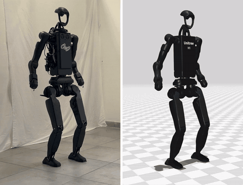
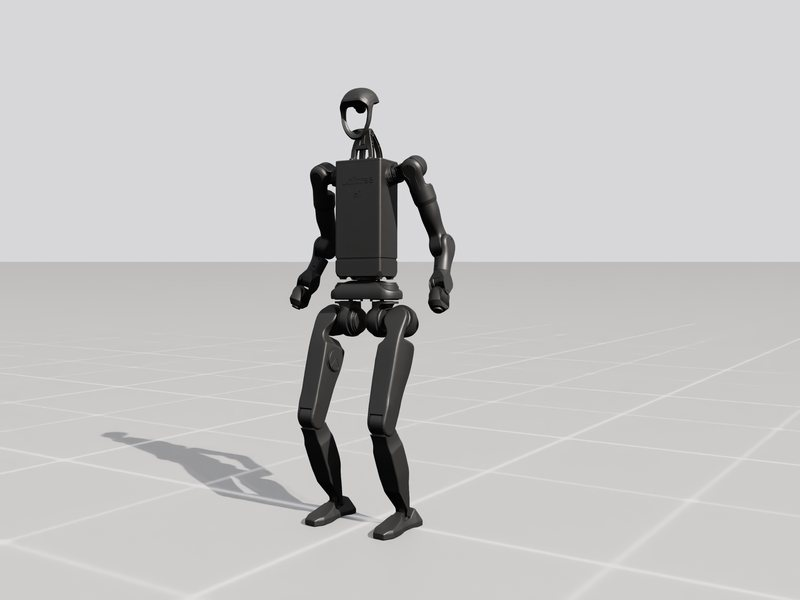
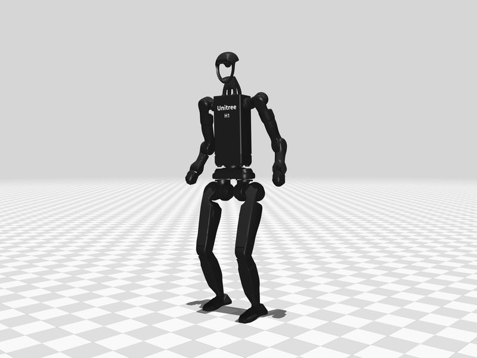
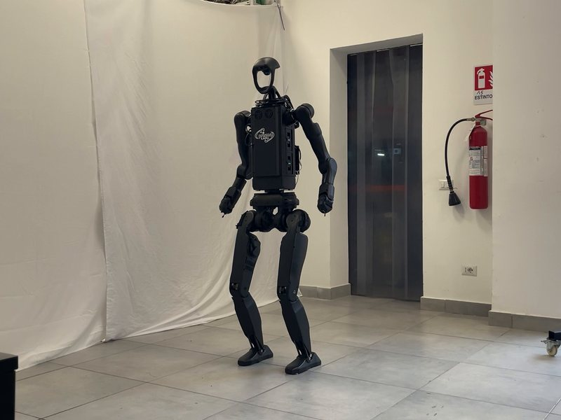

# H1_2 Squat Locomotion RL

<p align="center"></p>
<p align="center"><em>Squat on the physical H1_2 (left) and in its MuJoCo replay with the same commands (right), 2× speed.</em></p>

A single reinforcement-learning policy that makes the **Unitree H1_2** humanoid walk, turn, stand
still and **squat** on command, from the upright height (0.98 m) down to 0.60 m, and walk while
crouched down to 0.70 m. The policy is trained in Isaac Lab, validated sim-to-sim in MuJoCo and
deployed on the real robot with the same C++ controller.

|  |  |  |
|:---:|:---:|:---:|
| Training in Isaac Lab | Sim-to-sim in MuJoCo | The real Unitree H1_2 |

This repository contains everything needed to reproduce the work of the master's thesis
**Sim-to-Real Transfer of Reinforcement Learning Policies for Humanoid Robots** (Gaetano Torella,
University of Naples Federico II, Department of Electrical Engineering and Information Technology
(DIETI), PRISMA Lab, 2026):

| folder | content |
|---|---|
| [`training/`](training) | Isaac Lab extension: the H1_2 squat task (MDP, rewards, curriculum) and the train/play scripts |
| [`policies/`](policies/h1_2_squat/2026-09-13_21-27-39) | the final policy: ONNX/TorchScript export, configuration, last checkpoint |
| [`deploy/`](deploy) | C++ controller (FSM + ONNX policy) for sim2sim and for the real robot, with its Docker image |
| [`simulator/`](simulator) | MuJoCo simulator speaking the robot's DDS interface, for sim2sim |
| [`evaluation/`](evaluation) | automated sim2sim test protocols, metrics, run comparison, replay of real experiments |
| [`assets/h1_2/`](assets/h1_2) | robot description shared by training (URDF) and simulator (MJCF) |
| [`docs/`](docs) | the documentation (also published as the [GitHub Wiki](https://github.com/gaetanotorella/H1_2_Squat_Locomotion_RL/wiki)) |

## Results

On the physical robot, with the policy trained in simulation and no fine-tuning:

- **deep squat**: the base goes down by 0.36 m, 3.6 times the range of the factory controller, with
  the same posture as in simulation within about 1°;
- **locomotion while crouched**: walking, side-stepping and turning at 0.81 m, walking forwards at
  0.71 m;
- **push recovery**: 7 pushes out of 7 absorbed while standing, in at most 0.72 s, no falls.

Videos, plots and the comparison with simulation: [Results](https://github.com/gaetanotorella/H1_2_Squat_Locomotion_RL/wiki/Results).

## Documentation

The documentation is in the [Wiki](https://github.com/gaetanotorella/H1_2_Squat_Locomotion_RL/wiki):

1. [Installation](https://github.com/gaetanotorella/H1_2_Squat_Locomotion_RL/wiki/Installation): dependencies and exact versions, build of SDK, simulator and controller, Isaac Lab
2. [Training](https://github.com/gaetanotorella/H1_2_Squat_Locomotion_RL/wiki/Training): train, play and export a policy
3. [Training environment](https://github.com/gaetanotorella/H1_2_Squat_Locomotion_RL/wiki/Training-environment): commands, observations, actions, rewards, events, curriculum, terminations, PPO
4. [Controller](https://github.com/gaetanotorella/H1_2_Squat_Locomotion_RL/wiki/Controller): FSM, gamepad, how observations are built and fed to the policy, timing, safety
5. [Simulation](https://github.com/gaetanotorella/H1_2_Squat_Locomotion_RL/wiki/Simulation): sim2sim in MuJoCo with the gamepad
6. [Evaluation](https://github.com/gaetanotorella/H1_2_Squat_Locomotion_RL/wiki/Evaluation): automated protocols, metrics, comparison, replay of real experiments
7. [Real robot](https://github.com/gaetanotorella/H1_2_Squat_Locomotion_RL/wiki/Real-robot): deployment on the H1_2 with Docker, operating procedure
8. [Results](https://github.com/gaetanotorella/H1_2_Squat_Locomotion_RL/wiki/Results): images and videos of the thesis
9. [Building on this work](https://github.com/gaetanotorella/H1_2_Squat_Locomotion_RL/wiki/Building-on-this-work): what to reuse, how to extend it, sim-to-real lessons, open problems

Questions and problems: [GitHub issues](https://github.com/gaetanotorella/H1_2_Squat_Locomotion_RL/issues).

## Quick start (sim2sim)

```bash
git clone https://github.com/gaetanotorella/H1_2_Squat_Locomotion_RL.git && cd H1_2_Squat_Locomotion_RL
# first the apt packages of docs/installation.md § 2, then:
scripts/fetch_deps.sh && scripts/install_sdk.sh         # pinned unitree_sdk2 and MuJoCo
cmake -S simulator -B simulator/build && cmake --build simulator/build -j
cmake -S deploy/robots/h1_2_squat -B deploy/robots/h1_2_squat/build && cmake --build deploy/robots/h1_2_squat/build -j

simulator/build/unitree_mujoco                          # terminal 1 (gamepad connected)
deploy/robots/h1_2_squat/build/h1_2_ctrl_squat -n lo    # terminal 2
```

Then on the gamepad: `LT + up` (stand up), `RB + X` (start the policy), key `9` in the MuJoCo window
(release the elastic band). See [Simulation](https://github.com/gaetanotorella/H1_2_Squat_Locomotion_RL/wiki/Simulation) for all the controls.

## Software versions

| component | version |
|---|---|
| Isaac Sim / Isaac Lab | 5.1.0 / 2.3.2, Python 3.11, PyTorch 2.7.0 |
| rsl-rl-lib | 5.0.1 |
| unitree_sdk2 | commit `9754cd1` |
| MuJoCo (simulator) | 3.7.0 |
| onnxruntime (controller) | 1.22.0 |
| development PC | Ubuntu 22.04; robot onboard PC: Ubuntu 20.04 (controller in Docker) |

## Origin and licenses

This repository merges and extends:

- [unitreerobotics/unitree_rl_lab](https://github.com/unitreerobotics/unitree_rl_lab) (Apache-2.0): training framework and C++ deploy framework;
- [unitreerobotics/unitree_mujoco](https://github.com/unitreerobotics/unitree_mujoco) (BSD-3-Clause): the simulator;
- [unitreerobotics/unitree_ros](https://github.com/unitreerobotics/unitree_ros) (BSD-3-Clause): the H1_2 URDF and meshes.

See [THIRD_PARTY_NOTICES.md](THIRD_PARTY_NOTICES.md) for what comes from where and how it was
modified. The first commit of this repository holds the files kept here exactly as they were at the
end of the thesis; the development history before it, and the tools used to draw the figures of the
thesis, are kept in private archive repositories.

## Citation

```bibtex
@mastersthesis{torella2026simtoreal,
  author = {Torella, Gaetano},
  title  = {Sim-to-Real Transfer of Reinforcement Learning Policies for Humanoid Robots},
  school = {University of Naples Federico II, Department of Electrical Engineering and Information Technology (DIETI)},
  note   = {PRISMA Lab},
  year   = {2026},
  url    = {https://github.com/gaetanotorella/H1_2_Squat_Locomotion_RL}
}
```
