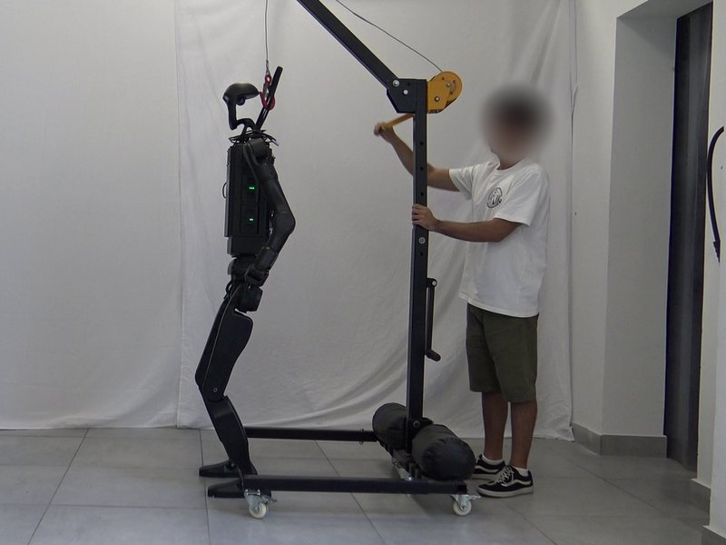
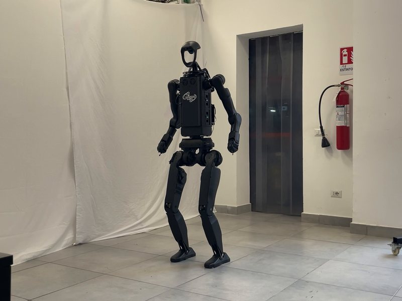

# Real robot

On the Unitree H1_2 the controller runs in a Docker container on the robot's onboard PC (PC2),
built on the development PC. The image (~240 MB) holds only the binary, its libraries and
`config.yaml`; the **policy is a volume**, so changing policy needs no rebuild. The same image also
runs sim2sim with interface `lo`.

| robot onboard PC (as used in the thesis) | |
|---|---|
| address | `ssh unitree@192.168.123.162` (robot network 192.168.123.0/24) |
| CPU, OS | Intel i7-1255U (x86_64), Ubuntu 20.04, gcc 9 |
| Docker | 24, user `unitree` in the `docker` group |
| robot interface | `eth0` |

The onboard PC is shared with Unitree's software: leave its images (e.g. `unitree_sdk2:latest`) and
files alone.

## Build and copy the image (development PC)

```bash
scripts/fetch_deps.sh                       # if not done yet: the image builds the pinned SDK
deploy/docker/build.sh                      # h1_2_ctrl_squat:x86_64; ~40 s with the cache
docker save h1_2_ctrl_squat:x86_64 | ssh unitree@192.168.123.162 docker load
```

`docker load` replaces the image with the same tag; the previous one stays as `<none>` and is
removed with `docker image prune -f`. To keep the previous version for a quick rollback, tag it first
on the robot: `docker tag h1_2_ctrl_squat:x86_64 h1_2_ctrl_squat:prev`.

`build.sh linux/arm64` builds for an aarch64 onboard PC (Jetson) via buildx and QEMU; it needs
`onnxruntime-linux-aarch64-1.22.0` extracted in `deploy/thirdparty/`.

## Copy the policy and the launcher (development PC)

```bash
rsync -a --relative deploy/docker/run.sh policies/h1_2_squat/2026-09-13_21-27-39 \
      unitree@192.168.123.162:H1_2_Squat_Locomotion_RL/
```

Only `exported/policy.onnx` and `params/deploy.yaml` are read; the checkpoint is not needed on the
robot.

## Operating procedure (on the robot)

**Before every start, put the robot in debug mode** (Unitree's own controller must not publish
`rt/lowcmd`). Otherwise the controller prints `The other process is using the lowcmd channel` and
two controllers would drive the motors: stop the container, enter debug mode, start again.

Safety rope or crane attached for the first tests: in the thesis, the robot was secured to a crane
with the rope kept slack while the policy was active, and only once the policy was validated it was
also run without any safety apparatus.

|  |  |
|:---:|:---:|
| Secured to the crane, rope slack | Without the safety apparatus |

```bash
cd ~/H1_2_Squat_Locomotion_RL
deploy/docker/run.sh eth0                   # final policy; or: deploy/docker/run.sh eth0 <policy folder>
docker logs -f h1_2_ctrl                    # follow the log (Ctrl-C closes only the log view)
```

The container runs detached (`-d`), so it survives a dropped SSH connection. Expected log:

```
Connected to robot.
Policy directory: .../2026-09-13_21-27-39
FSM: Start Passive
```

On the Unitree remote:

1. `L2 + up`: FixStand (3 s ramp to the default pose);
2. `R1 + X`: Squat, the policy starts; the CSV log folder is printed (`[run_logger] ... exp_<ts>`);
3. drive: left stick vx/vy, right stick wz; `R2` held lowers the height and stops at 0.71 m,
   `A + R2` goes down to 0.60 m, `B` stands up. The height is printed in the log;
4. `L2 + B`: Passive.

**Shutdown: first `L2 + B` (Passive), then `docker stop h1_2_ctrl`.** The controller does not handle
SIGTERM: `docker stop` kills it after 10 s, so it must never be stopped while the robot is in RL.

An unwanted transition to Passive has two causes, shown in the log: `L2 + B`, or the lowstate
timeout (no robot state for more than 1 s).

## Logs

`run.sh` passes `--log`: every RL session writes `sim_logs/exp_<timestamp>/` on the robot
(`obs.csv`, `commands.csv`, `errors.csv`, `run_info.md`). Copy them back and analyse them:

```bash
rsync -av unitree@192.168.123.162:H1_2_Squat_Locomotion_RL/sim_logs/exp_* sim_logs/
python evaluation/analyze_sim.py sim_logs/exp_<timestamp>
python evaluation/replay_experiment.py sim_logs/exp_<timestamp>     # same commands in simulation
```

## What needs a rebuild

| change | rebuild the image? |
|---|---|
| C++ code (`deploy/include/`, `deploy/robots/h1_2_squat/`) | yes |
| `deploy/robots/h1_2_squat/config/config.yaml` (FSM, FixStand/Passive gains) | yes, it is copied into the image |
| policy (`exported/policy.onnx`, `params/deploy.yaml`) | no, copy the folder and pass it to `run.sh` |

To try another `config.yaml` without rebuilding, add to the `docker run` of `run.sh`:
`-v /path/config.yaml:/root/H1_2_Squat_Locomotion_RL/deploy/robots/h1_2_squat/config/config.yaml:ro`.

## Network check

From a laptop connected to the robot network, `deploy/scripts/probe_dds.sh <interface>` lists the
DDS applications and topics, and the type of `rt/lowstate`, `rt/lowcmd`, `rt/wirelesscontroller`
(needs `pip install cyclonedds==0.10.2`). It only reads discovery information.

## Without Docker

The controller also builds natively on the onboard PC (Ubuntu 20.04, gcc 9): install the apt
packages and the SDK as in [Installation](installation.md), then build `deploy/robots/h1_2_squat`.
Docker is preferred because it leaves the onboard PC untouched.
