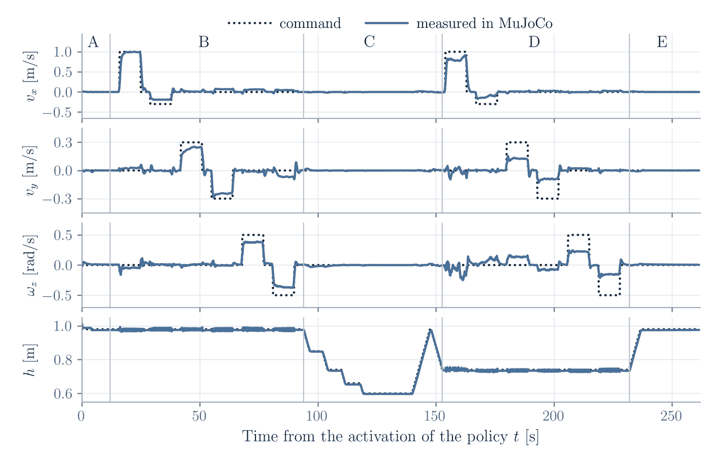
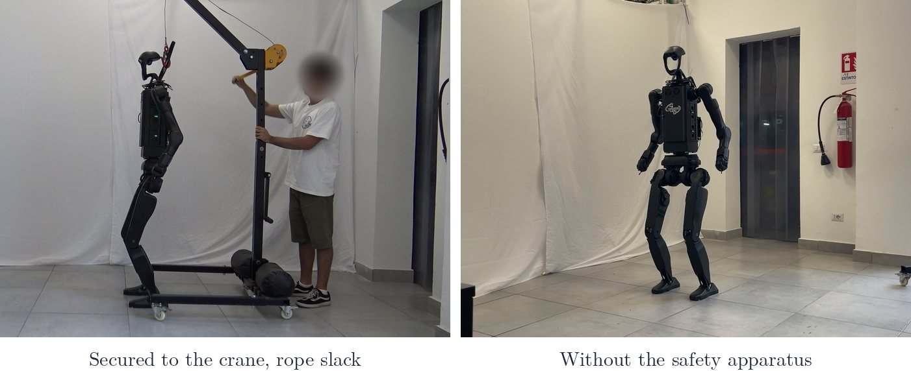
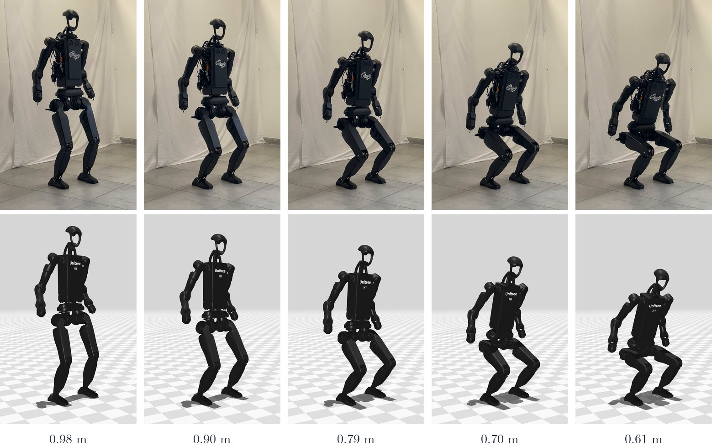
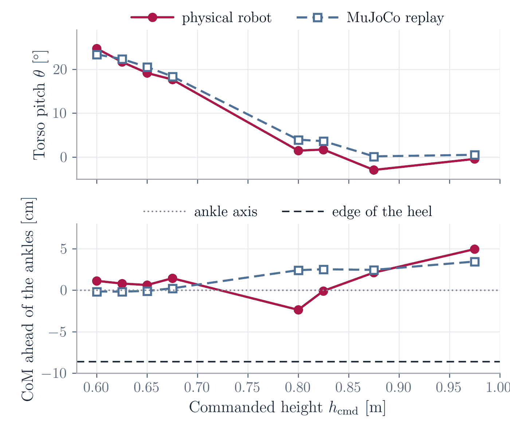

# Results

The final policy (`policies/h1_2_squat/2026-09-13_21-27-39`) evaluated in three stages: in the
4096 parallel environments of Isaac Lab where it was trained, sim-to-sim in MuJoCo on a fixed
protocol, and on the physical Unitree H1_2 in five sessions, each replayed in MuJoCo with exactly the
same commands. The numbers are those of Chapter 6 of the thesis; the videos are also in
[`docs/media/videos/`](media/videos).

| objective | result on the physical robot |
|---|---|
| deep squat | the base goes down by **0.36 m**, from 0.98 to 0.62 m: 3.6 times the 0.10 m of the factory controller |
| locomotion while crouched | walking, side-stepping and turning at 0.81 m, **walking forwards at 0.71 m**; in simulation, all directions at 0.74 m |
| push recovery | **7 pushes out of 7** absorbed while standing, posture recovered in at most 0.72 s, no falls |
| sim-to-real agreement | torso lean at the deepest height 23.4° on the robot, 22.9° in the replay; the robot stops 1.5–2 cm higher |

## 1. Training

https://github.com/user-attachments/assets/f78b06cd-409d-49df-a400-b61ed613fa8e

*The final policy in the 4096 parallel environments of Isaac Lab, with random height and velocity
commands.*

A single network, trained with PPO in an asymmetric actor-critic architecture, tracks a height
command between 0.60 and 0.98 m together with the planar velocity commands, so that no switching
between controllers is needed when the robot crouches, walks or is pushed. It was trained in one run
of about 2 hours (5000 iterations, see the curves in [Training](training.md#the-final-policy)) and
runs on the robot without fine-tuning. The environment is described in
[Training environment](training_environment.md).

## 2. Sim-to-sim in MuJoCo

Before the robot, every policy runs the standard protocol `evaluation/protocols/standard_v1.yaml` in
MuJoCo, with the same C++ controller used on the robot and a scripted gamepad: 262 s with standing,
the six velocity manoeuvres at the limits of the command ranges at 0.98 m, a descent to 0.60 m and
the same six manoeuvres at 0.74 m ([Evaluation](evaluation.md#the-standard-protocols)).

https://github.com/user-attachments/assets/57411b7b-a622-4644-ba3c-55d5c485fe3f

*Phase D of the protocol, the six manoeuvres at 0.74 m, at 3× speed, with the commands and the
velocities measured in MuJoCo.*



| command | gain at 0.98 m | gain at 0.74 m |
|---|---|---|
| forwards, 1.0 m/s | 0.99 | 0.82 |
| backwards, 0.3 m/s | 0.63 | 0.36 |
| left / right, 0.3 m/s | 0.80 / 0.83 | 0.42 / 0.29 |
| turn left / right, 0.5 rad/s | 0.75 / 0.73 | 0.45 / 0.32 |

The gain is the ratio between the measured and the commanded velocity. The height error stays below
1 cm at every height, and the torso leans forwards as the robot goes down: 11.4° at 0.74 m, 19.4° at
0.66 m, 24.0° at 0.60 m, where the robot holds still for 21 s with a roll standard deviation of
0.04°. The weak point is straightness: the yaw rate drifts with the commanded velocity, and the
forward walk at 1.0 m/s deviates laterally by 0.81 m over 6.84 m at 0.98 m, and by 1.91 m over
5.21 m at 0.74 m.

To reproduce the table, with the simulator and the controller built
([Installation](installation.md)):

```bash
python evaluation/run_protocol.py --protocol evaluation/protocols/standard_v1.yaml
```

A run with this repository gives the same gains within ±0.03.

## 3. On the physical robot



The controller runs in its Docker container on the robot's onboard PC, the same binary as in
simulation. The robot hangs from a crane with the rope kept slack while the policy is active; in the
third session it operated without any safety apparatus. Five sessions of a few minutes each:

| session | content | duration [s] | min. commanded height [m] |
|---|---|---|---|
| 1 | squat, locomotion | 213 | 0.61 |
| 2 | squat, locomotion | 158 | 0.63 |
| 3 | squat, locomotion | 271 | 0.61 |
| 4 | push test | 213 | 0.98 |
| 5 | squat, locomotion | 178 | 0.60 |

Every session is replayed in MuJoCo with the commands recorded by the controller
([Evaluation § Replaying a real experiment](evaluation.md#replaying-a-real-experiment)): the commands
seen by the policy in the replay differ from the real ones by less than 0.001 m/s RMS, so the physical
and the simulated robot can be compared step by step. The robot has no ground truth: its height
comes from forward kinematics on the measured joints and IMU, its inclination from the IMU, and the
position of its centre of mass (CoM) from the steady-state ankle torque.

### Deep squat

https://github.com/user-attachments/assets/9ba5a2b7-e4da-422e-9b48-ba59747ec99e

*Session 3: the physical robot, its MuJoCo replay, and the height h and torso pitch θ of both, with
their difference.*



*The descent of session 3, physical robot (top) and MuJoCo replay (bottom) at the same instants,
labelled with the commanded height.*

In session 5 the base settles at 0.981 m when standing and reaches 0.619 m at the lower end of the
height range: 0.36 m of excursion, 3.6 times the range of the factory controller. Unlike the factory
controller, which keeps the torso upright, the policy leans it forwards as it goes down, by 24.1° at
0.60 m, the same on the robot and in the replay. The heights of the two coincide down to about
0.65 m; at the deepest point the physical robot stays 1.5–2 cm higher.

### Locomotion while crouched

https://github.com/user-attachments/assets/c2eecfce-0adc-412e-bc12-1b9c6d1e68a5

*Session 5: walking forwards at 0.71 m, the lowest height at which the velocity commands are
accepted, next to the replay, with the velocity command and the height and pitch of both.*

In sessions 1–3 the robot walked, stepped sideways and turned in place while crouched down to
0.81 m, with commands up to 0.29 m/s forwards and backwards, 0.30 m/s sideways and 0.50 rad/s. In
session 5 it walked forwards at 0.71 m, 71% of the height excursion: estimated height 0.707 m on both
the robot and the replay, torso lean 14.2° against 16.1°. The gait is the same as in simulation (knee
oscillation of 2.8–4.9° against 2.8–4.3°, torso angular velocity 0.30 rad/s in both).

### Push recovery

https://github.com/user-attachments/assets/f0f8d6dc-88de-478d-977e-1e00cea6c933

*Session 4: two of the seven pushes, given with a rigid pole to the standing robot, with the angular
velocity and the inclination of the torso.*

| push | time [s] | peak angular velocity [rad/s] | peak extra inclination [°] | recovery [s] |
|---|---|---|---|---|
| 1 | 47.9 | 0.92 | 2.7 | 0.44 |
| 2 | 57.6 | 0.85 | 2.0 | 0.54 |
| 3 | 67.5 | 0.98 | 2.0 | 0.44 |
| 4 | 73.2 | 1.17 | 1.4 | 0.72 |
| 5 | 134.5 | 0.86 | 3.4 | 0.38 |
| 6 | 138.4 | 0.74 | 2.5 | 0.40 |
| 7 | 155.6 | 0.56 | 1.1 | 0.36 |

A push is detected when the angular velocity of the torso exceeds 0.5 rad/s with zero command, and
recovered when it stays below 0.15 rad/s for 0.5 s. In the replay of the same session, which has no
pushes, the angular velocity stays below 0.01 rad/s on average.

## 4. Closing the sim-to-real gap

Going far from the nominal posture amplifies the differences between simulation and hardware. During
the development, the steady-state torque of the ankles showed that on the physical robot the CoM lay
3–6 cm further behind the ankle axis than in simulation, eating into the margin against tipping
backwards over the heels.
Forward kinematics on the measured joints showed the cause: the ankles of the real robot yield more
under load, so its posture differs, while its mass distribution matches the model. The training
environment compensates for it with a randomization of the CoM position (a rigid displacement of up
to ±6 cm fore-aft), an orientation penalty that only penalises leaning backwards, and a penalty on the
ankle torque.



*Steady-state torso pitch and CoM position versus commanded height, physical robot and replays
(sessions 1–4). The edge of the heel is 8.6 cm behind the ankle axis.*

| | standing, robot | standing, replay | deepest, robot | deepest, replay | crouched walk, robot | crouched walk, replay |
|---|---|---|---|---|---|---|
| pitch [°] | −0.4 ± 0.7 | +0.5 ± 0.5 | +23.4 ± 1.5 | +22.9 ± 0.5 | +3.8 ± 2.5 | +6.1 ± 2.6 |
| roll [°] | +1.1 ± 0.5 | +0.9 ± 0.2 | −1.5 ± 0.6 | +0.2 ± 0.1 | +0.8 ± 1.4 | +0.7 ± 1.4 |
| CoM ahead of the ankles [cm] | +4.9 ± 3.1 | +3.5 ± 0.7 | +1.0 ± 0.5 | −0.2 ± 0.2 | – | – |
| height error [cm] | −0.2 ± 0.3 | −0.2 ± 0.1 | +1.2 ± 0.3 | −0.3 ± 0.1 | −0.1 ± 0.4 | 0.0 ± 0.3 |
| torso angular velocity [rad/s] | 0.020 | 0.007 | 0.018 | 0.008 | 0.305 | 0.302 |

With the final policy the CoM of the physical robot stays on average more than 6 cm in front of the
edge of the heel at every height, without any additional sensor. The residual differences (a
slightly higher deepest point, a larger oscillation at rest, a CoM that varies more across sessions)
are small with respect to the stability margins.

## 5. Limitations

- **Heading drift.** The heading is not commanded (the operator commands the yaw rate) and the robot
  turns while walking, at a rate that grows with the commanded velocity.
- **Less authority while crouched.** At 0.74 m the forward gain is still 0.82, but the backward,
  lateral and turning gains drop to 0.29–0.45.
- **Experimental evidence.** On the hardware, below 0.79 m only the forward walk was tested, turning in
  place essentially only counterclockwise, and the pushes were manual, of unknown magnitude, on the
  standing robot. The velocity tracking on the robot is inferred from the replays, and the policy
  comes from a single training run.
- **Modelling.** The actuators are ideal PD elements (no latency, friction or transmission
  compliance), the ground is flat, and the policy uses proprioception only.

Ways forward, from the thesis: a heading command with odometry, velocity ranges conditioned on the
height, an actuator model identified on the robot, and loco-manipulation at low working heights with
the dexterous hands.
