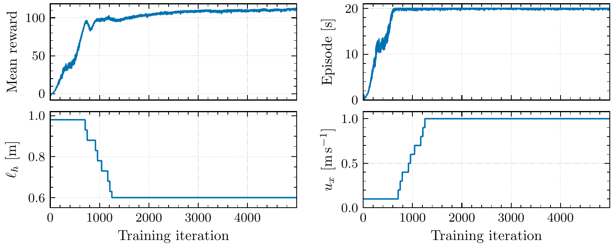

# Training

Requires the Isaac Lab environment of [Installation § 6](installation.md#6-isaac-lab-training-pc).
The commands run from `training/`; runs are written to `training/logs/rsl_rl/unitree_h1_2_squat/<date_time>/`
(ignored by git).


*Part of the 4096 parallel environments, with robots commanded to different heights and velocities.*

## Train

```bash
cd training
python scripts/rsl_rl/train.py --task Unitree-H1_2-Squat --headless --max_iterations 5000
# equivalent wrapper, with task-name completion: ./unitree_rl_lab.sh -t --task Unitree-H1_2-Squat --max_iterations 5000
```

The final policy was trained with these settings: 4096 environments, 5000 iterations (about 491 M
environment steps), seed 42. Useful options: `--num_envs`, `--seed`, `--resume --load_run <run>
--checkpoint model_<it>.pt`, `--video`.

TensorBoard:

```bash
tensorboard --logdir logs/rsl_rl/unitree_h1_2_squat
```

Besides the losses and the reward terms, check `Curriculum/lin_vel_cmd_levels` (upper bound of the
forward command, must reach 1.0) and `Curriculum/height_cmd_levels` (lowest commanded height, must
reach 0.60): see [Training environment § Curriculum](training_environment.md#curriculum).

## Content of a run

```
<date_time>/
├── model_<it>.pt            checkpoints, every 100 iterations
├── params/
│   ├── env.yaml, agent.yaml full environment and PPO configuration
│   └── deploy.yaml          what the C++ controller needs (see below)
├── exported/                written by play.py
│   ├── policy.onnx          used by the controller
│   └── policy.pt            TorchScript
└── events.out.tfevents.*    TensorBoard
```

`deploy.yaml` is generated by `unitree_rl_lab/utils/export_deploy_cfg.py` from the environment: joint
order and its mapping to the SDK motor order, kp/kd, default pose, action scale and offset, the
observation terms with their scales and history, the command ranges and the velocity cutoff height.
The controller reads only this file and `policy.onnx`.

## Play and export

```bash
python scripts/rsl_rl/play.py --task Unitree-H1_2-Squat --num_envs 32 --load_run <date_time>
```

It runs the policy in Isaac Sim with the full command ranges and **writes `exported/policy.onnx`,
`exported/policy.pt` and regenerates `params/deploy.yaml`** of that run. Never run it on a policy
that has already been validated on the robot: the files the robot loads would be rewritten.

## Promote a new policy

The controller and the evaluation tools load policies from `policies/h1_2_squat/`, taking the newest
folder that contains `exported/` (or the one given explicitly):

```bash
mkdir -p ../policies/h1_2_squat/<date_time>
cp -r logs/rsl_rl/unitree_h1_2_squat/<date_time>/{exported,params} ../policies/h1_2_squat/<date_time>/
```

Then validate it in simulation before the robot: [Evaluation](evaluation.md).

## The final policy

`policies/h1_2_squat/2026-09-13_21-27-39/`: exported policy, configuration (`params/`, including
the `squat_env_cfg.py` snapshot recorded at training time) and the last checkpoint
`model_4999.pt`, to resume or fine-tune:

```bash
mkdir -p logs/rsl_rl/unitree_h1_2_squat/2026-09-13_21-27-39
cp ../policies/h1_2_squat/2026-09-13_21-27-39/model_4999.pt logs/rsl_rl/unitree_h1_2_squat/2026-09-13_21-27-39/
python scripts/rsl_rl/train.py --task Unitree-H1_2-Squat --headless --resume \
    --load_run 2026-09-13_21-27-39 --checkpoint model_4999.pt --max_iterations 1000
```

`params/env.yaml` is kept exactly as recorded, so it still contains the URDF path of the training
machine of the time.

Its training, a single run of about 2 hours, is a reference for what a healthy run looks like in
TensorBoard:



*Top: mean episode reward and episode length (20 s = no falls). Bottom: the two curricula, the lower
end ℓ<sub>h</sub> of the height command, which goes from 0.98 to 0.60 m, and the upper end u<sub>x</sub>
of the forward velocity, which goes from 0.1 to 1.0 m/s; both are complete by iteration ~1300.*
