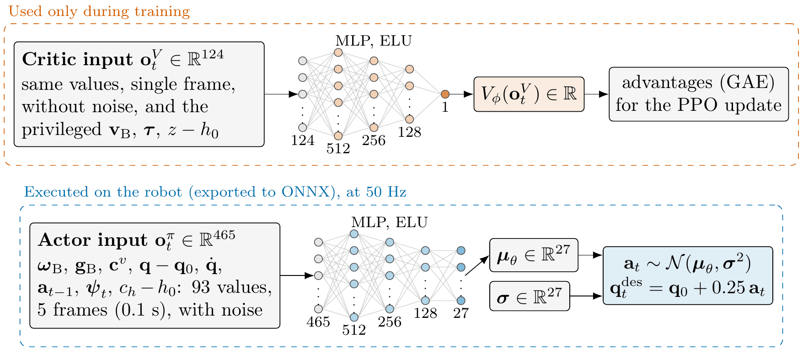

# Training environment

Task `Unitree-H1_2-Squat`, defined in
`training/source/unitree_rl_lab/unitree_rl_lab/tasks/locomotion/robots/h1_2/`:

- `velocity_env_cfg.py`: the walking task (scene, velocity command, observations, rewards, events);
- `squat_env_cfg.py`: extends it with the height command, its observations, the squat rewards and
  the height curriculum.

The custom terms are in `tasks/locomotion/mdp/`. All values below are those of the final policy
(`policies/h1_2_squat/2026-09-13_21-27-39/params/env.yaml`).

## Overview

| | |
|---|---|
| robot | Unitree H1_2 without hands, 27 joints (12 legs, 1 torso, 14 arms), URDF from `assets/h1_2/` |
| simulation | PhysX, dt = 5 ms; policy at 50 Hz (decimation 4) |
| episode | 20 s; 4096 parallel environments on flat ground |
| actor-critic | asymmetric: the critic also sees privileged quantities (true base velocity and height, joint torques) |
| algorithm | PPO (rsl-rl 5.0.1) |

*The critic (top) is used only in training and sees one frame of privileged, noise-free
observations; the actor (bottom) is the network exported to ONNX and run on the robot, with 5 frames
of noisy observations as input.*

## Robot and actuators

Ideal PD actuators (`IdealPDActuatorCfg`), with the gains of the controller's FixStand state, so
that training and robot use the same kp/kd:

| group | joints | kp | kd | effort limit [N·m] |
|---|---|---|---|---|
| hips, torso | hip yaw/pitch/roll, torso | 250 (torso 600) | 6.5 (torso 6) | 200 |
| knees | knee | 400 | 10 | 300 |
| ankle pitch | ankle_pitch | 80 | 1.5 | 60 |
| ankle roll | ankle_roll | 40 | 0.4 | 40 |
| shoulder pitch/roll | shoulder pitch, roll | 250 / 400 | 6 / 10 | 40 |
| shoulder yaw, elbow | shoulder_yaw, elbow | 80 | 2 | 18 |
| wrists | wrist roll/pitch/yaw | 20 | 0.5 | 19 |

Armature 0.01 on every joint. Default pose: hips pitch −0.3, knees 0.5, ankles pitch −0.2,
shoulders pitch 0.35, roll ±0.25, yaw −0.1, elbows 0.65 rad. Initial base height 1.0 m.

## Commands

**Velocity** (`base_velocity`, `UniformLevelVelocityCommand`): body-frame `vx, vy, wz`, resampled
every 10 s.

| | value |
|---|---|
| full ranges (reached through the curriculum) | vx [−0.3, 1.0] m/s, vy [−0.3, 0.3] m/s, wz [−0.5, 0.5] rad/s |
| initial ranges | ±0.1 on each axis |
| standing environments | 20% (command forced to zero) |
| turning in place | 15% of the moving environments: zero linear command, yaw at 50–100% of the current range |

**Height** (`base_height`, `UniformHeightCommand`): absolute base height target, resampled every
5–8 s.

| | value |
|---|---|
| nominal (standing) height | 0.98 m |
| full range (reached through the curriculum) | [0.60, 0.98] m |
| who squats | all the standing environments, plus 35% of the walking ones |
| floor while walking | 0.70 m: walking environments sample heights in [0.70, 0.98] |

The 0.70 m floor is exported to `deploy.yaml` as `cutoff_height`: below it the controller zeroes
the velocity command, since the policy was never trained to walk that low.

## Observations

Actor (`policy` group), **5 frames of history** (100 ms), concatenated per term (5 frames of term 1,
then 5 of term 2, ...), from the oldest to the newest. 93 values per frame, 465 in total:

| term | dim | scale | noise (uniform) |
|---|---|---|---|
| `base_ang_vel` (IMU gyroscope) | 3 | 0.2 | ±0.2 |
| `projected_gravity` (IMU) | 3 | 1 | ±0.05 |
| `velocity_commands` | 3 | 1 | — |
| `joint_pos_rel` (position − default) | 27 | 1 | ±0.01 |
| `joint_vel_rel` | 27 | 0.05 | ±1.5 |
| `last_action` | 27 | 1 | — |
| `gait_phase` (sin, cos of a 0.8 s clock) | 2 | 1 | — |
| `base_height_command` (target − 0.98) | 1 | 1 | — |

Everything is available on the real robot: the policy infers its own height from the joint
positions. The history lets it infer persistent, unobservable parameters such as the CoM offset
(see the events below). The gait clock outputs (0, 0) when the velocity command is below 0.1, so the
robot stands still instead of stepping in place.

Critic (`critic` group, single frame, no noise): the same terms plus the privileged
`base_lin_vel` (3), `joint_effort` (27, scale 0.01) and the true `base_height` (1, relative to 0.98).

## Actions

Joint position targets for all 27 joints: `q_target = default_pose + 0.25 · action`, no clipping.
In training the PD law is evaluated at every physics step (200 Hz); on the robot the controller sends
targets and gains at 1 kHz and the PD law runs in the motor drivers.

## Rewards

Positive weights reward, negative ones penalize. The custom functions are in `mdp/rewards.py`.

**Velocity tracking**

| term | function | weight | notes |
|---|---|---|---|
| `track_lin_vel_xy` | `track_lin_vel_xy_yaw_frame_exp` | 1.0 | std 0.5 |
| `track_ang_vel_z` | `track_ang_vel_z_exp` | 1.0 | std 0.5 |
| `track_lin_vel_xy_fine` | `track_lin_vel_xy_yaw_frame_exp` | 0.5 | std 0.25: narrow kernel, more reward for precise tracking |
| `track_ang_vel_z_fine` | `track_ang_vel_z_exp` | 0.5 | std 0.25 |
| `alive` | `is_alive` | 0.15 | |

**Squat**

| term | function | weight | notes |
|---|---|---|---|
| `track_base_height` | `track_base_height_exp` | 3.0 | exp(−(h − h_cmd)² / 0.07²), true base height |
| `settle_height` | `lin_vel_z_gated` | −2.0 | vertical velocity², only within 5 cm of the target (does not fight the descent) |
| `squat_symmetry` | `joint_mirror` | −1.0 | (L − R)² of hip pitch, knee, ankle pitch, standing environments only |
| `roll_symmetry` | `joint_mirror_antisym` | −0.3 | (L + R)² of hip roll and ankle roll |
| `double_support` | `feet_contact_without_cmd` | 0.5 | feet in contact when there is no velocity command |
| `feet_too_near` | `feet_too_near` | −2.0 | feet closer than 0.2 m |
| `ankle_torque_margin` | `ankle_torque_standing` | −7e-4 | \|ankle pitch torque\| when settled at the commanded height: keeps the CoM above the ankles |
| `ankle_action_smoothness` | `joint_action_rate_standing` | −0.04 | action rate of the ankles, standing environments only (damps an ankle limit cycle) |
| `flat_orientation` | `flat_orientation_asym` | −5.0 | roll² and backward pitch² always; forward pitch only beyond a deadband growing with depth (up to ~25° at 0.60 m) |

**Regularization and posture**

| term | function | weight |
|---|---|---|
| `base_angular_velocity` | `ang_vel_xy_l2` | −0.05 |
| `joint_vel` | `joint_vel_l2` | −0.001 |
| `joint_acc` | `joint_acc_l2` | −2.5e-7 |
| `action_rate` | `action_rate_l2` | −0.05 |
| `dof_pos_limits` | `joint_pos_limits` | −5.0 |
| `energy` | `energy` (\|q̇\|·\|τ\|) | −2e-5 |
| `stand_still_zero_cmd` | `stand_still_zero_cmd` | −0.1 (deviation from the default pose, standing environments) |
| `joint_deviation_arms` | `joint_deviation_l1` | −0.1 |
| `joint_deviation_torso` | `joint_deviation_l1` | −1.0 |
| `joint_deviation_hip_roll` | `joint_deviation_l1` | −1.0 |
| `joint_deviation_hip_yaw` | `joint_deviation_l1` | −0.25 |

**Feet and contacts**

| term | function | weight | notes |
|---|---|---|---|
| `gait` | `feet_gait` | 0.5 | contact pattern of a 0.8 s gait, feet in anti-phase, 55% stance; only with a velocity command |
| `feet_clearance` | `foot_clearance_reward` | 1.0 | swing foot at 0.1 m |
| `feet_slide` | `feet_slide` | −0.2 | |
| `feet_contact_forces` | `contact_forces` | −2e-4 | above 500 N |
| `undesired_contacts` | `undesired_contacts` | −1.0 | any body other than the feet |

The walking task's `base_height`, `flat_orientation_l2` and `base_linear_velocity` are disabled in
the squat task and replaced by `track_base_height`, `flat_orientation` and `settle_height`.
`mdp/rewards.py` also keeps functions not used by this configuration (e.g. `heading_hold`,
`path_hold`, `lateral_drift_on_turn`, and the ones of the other Unitree robots), listed in its
module docstring.

## Events (domain randomization)

| event | when | randomization |
|---|---|---|
| `physics_material` | startup | static and dynamic friction 0.3–1.0 on every body |
| `add_base_mass` | startup | +[−1, 3] kg on the torso |
| `randomize_link_masses` | startup | every link mass × [0.85, 1.15] |
| `randomize_actuator_gains` | startup | kp and kd × [0.8, 1.2] |
| `randomize_base_com` | reset | CoM shift x ±6 cm, y ±2 cm, z ±2 cm, the same for every link (a rigid shift of the whole-body CoM) |
| `reset_base` | reset | position ±0.5 m, any yaw |
| `reset_robot_joints` | reset | default pose, joint velocities ±1 rad/s |
| `push_robot` | every 5 s | base velocity kick ±0.5 m/s in x and y |

The CoM randomization is the term that closed the sim-to-real gap: on the real robot the CoM was
3–6 cm further back than in the model. Resampled at every reset, it forces the policy to infer the
offset from its observation history.

## Curriculum

Both are evaluated once per episode length and only widen the ranges:

| term | rule |
|---|---|
| `lin_vel_cmd_levels` | if `track_lin_vel_xy` > 80% of its maximum: vx and vy ranges widened by ±0.1 (up to the full ranges). Independently, if `track_ang_vel_z` > 55% of its maximum: wz range widened by ±0.1 |
| `height_cmd_levels` | if `track_lin_vel_xy` > 80% **and** `track_base_height` > 80% of their maxima: the lowest height decreases by 5 cm (down to 0.60 m) |

So the policy learns to walk and stand first, and squats deeper only once both skills are good.
The terrain curriculum is disabled (flat ground only).

## Terminations

| term | condition |
|---|---|
| `time_out` | 20 s (not a failure) |
| `base_height` | base below 0.5 m |
| `base_contact` | contact force on the torso above 1 N |

## PPO

| | value |
|---|---|
| actor / critic | MLP 512-256-128, ELU, separate networks |
| action distribution | Gaussian, initial std 1.0 (scalar) |
| steps per environment per iteration | 24 (98 304 samples per iteration) |
| epochs / mini-batches | 5 / 4 |
| learning rate | 1e-3, adaptive (desired KL 0.01) |
| γ / λ | 0.99 / 0.95 |
| clip / entropy / value loss coef. | 0.2 / 0.01 / 1.0 |
| max grad norm | 1.0 |
| iterations | 5000 |
